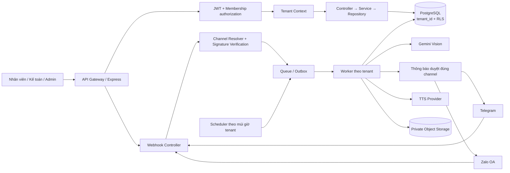
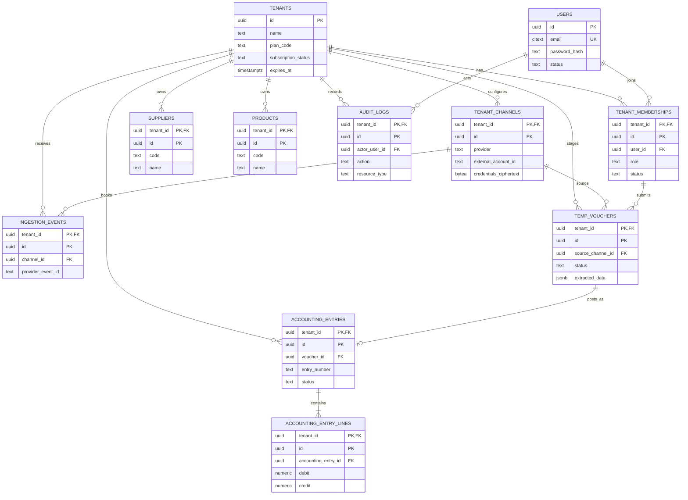

# NovaBooks — Kiến trúc Multi-Tenant và mô hình dữ liệu

**Phiên bản:** 1.0

**Trạng thái:** Bản thiết kế Bước 2–3
**Nền tảng mục tiêu:** Node.js + TypeScript, PostgreSQL

## 1. Quyết định kiến trúc

- **Tenancy:** Shared Database, Shared Schema; mọi dữ liệu nghiệp vụ thuộc tenant có `tenant_id`.
- **Phòng thủ nhiều lớp:** JWT/membership → tenant context bắt buộc → repository nhận context rõ ràng → khóa ngoại ghép tenant → PostgreSQL Row-Level Security (RLS).
- **Danh tính:** `users` là danh tính toàn cục; `tenant_memberships` lưu vai trò và trạng thái theo tenant. Một user có thể thuộc nhiều tenant.
- **Webhook:** tra cứu cấu hình kênh bằng route key ngẫu nhiên/định danh provider, xác minh chữ ký hoặc secret, sau đó mới tạo tenant context.
- **Xử lý bất đồng bộ:** webhook ghi nhận idempotent rồi enqueue; worker xử lý AI, duyệt và TTS trong transaction có tenant context riêng.
- **Bí mật:** credential mã hóa phía ứng dụng/KMS; DB chỉ lưu ciphertext, không lưu token thô.

## 2. Sơ đồ luồng và thành phần



### 2.1 Luồng API người dùng

1. Xác minh chữ ký, issuer, audience, thời hạn và session/JWT.
2. Lấy tenant đang hoạt động từ claim `active_tenant_id` đã ký; không tin `tenant_id` trong body/query/header tùy ý.
3. Kiểm tra tenant và membership còn hoạt động, vai trò đủ quyền; membership có thể cache ngắn hạn nhưng cần cơ chế thu hồi.
4. Tạo transaction; ngay đầu transaction gọi `SELECT set_config('app.tenant_id', $1, true)`.
5. Repository chỉ truy vấn qua transaction-scoped client; RLS tự áp tenant hiện hành. Commit/rollback giải phóng context cùng transaction.

Nếu người dùng có nhiều tenant, thao tác chuyển tenant tạo/đổi active tenant qua endpoint kiểm tra membership; không chấp nhận tenant khác chỉ vì client sửa claim.

### 2.2 Middleware và kiểu context (mẫu)

```ts
type TenantContext = {
  tenantId: string;
  userId: string;
  membershipId: string;
  role: "tenant_admin" | "accountant" | "staff";
  requestId: string;
};

// Thứ tự middleware: authenticate -> resolve active tenant -> authorize -> handler.
// Transaction layer phải bind tenantId bằng SET LOCAL trước mọi truy vấn nghiệp vụ.
```

`TenantContext` được tạo từ access token đã xác minh và membership DB; không khởi tạo từ input công khai. Webhook dùng context riêng không có user đăng nhập, nhưng tenant/channel chỉ được thiết lập sau khi resolver tìm được channel đã bật và xác minh request thành công.

### 2.3 Tenant Interceptor / Query Scoping

Không nên “tự động nối `WHERE tenant_id = ?`” bằng cách sửa SQL tùy ý: cách này dễ bỏ sót với join, subquery, bulk update và truy vấn raw. Thiết kế chuẩn:

- Controller không truy cập DB trực tiếp; truyền `TenantContext` vào service.
- Service mở transaction qua `withTenantTransaction(context, callback)`.
- Transaction helper bind tenant bằng `set_config(..., true)` và đưa typed transaction client cho repository.
- Repository method tenant-scoped yêu cầu `TenantContext`/`tenantId` rõ ràng; tránh API repository không tenant-scoped cho bảng nghiệp vụ.
- RLS áp trên mọi bảng có tenant; khóa ngoại ghép chặn liên kết chéo tenant.
- Truy vấn platform/admin được tách thành service và DB role riêng, giới hạn bảng/chức năng; không tái sử dụng credential platform trong API tenant.

Ví dụ pseudo-code:

```ts
async function withTenantTransaction<T>(
  tenantId: string,
  work: (tx: TenantTransaction) => Promise<T>,
): Promise<T> {
  return db.transaction(async (tx) => {
    await tx.query("SELECT set_config('app.tenant_id', $1, true)", [tenantId]);
    return work(tx);
  });
}
```

Không dùng `SET app.tenant_id = ...` ở cấp session/connection pool. Role runtime không phải table owner, không có `BYPASSRLS`; tài khoản migration riêng. Superuser/table owner có thể vượt RLS nên không dùng cho ứng dụng.

### 2.4 Định tuyến Telegram

- Mỗi tenant kết nối bot riêng; dùng Telegram `getMe` để xác nhận bot và ghi `external_account_id` sau khi kết nối.
- Đăng ký webhook với URL chứa route key ngẫu nhiên khó đoán; DB chỉ lưu SHA-256 của route key. Cấu hình `secret_token` và xác minh `X-Telegram-Bot-Api-Secret-Token` theo cấu hình chính thức.
- Resolver tìm channel bằng hash route key, kiểm tra `provider`, trạng thái channel/tenant, xác minh header bằng so sánh constant-time, sau đó mới nhận event.
- Không đặt bot token trong URL webhook, log, error trace hay response. Khi gọi Telegram API, giải mã credential trong phạm vi worker cần dùng rồi xóa khỏi bộ nhớ sớm nhất có thể.
- Lưu `update_id` với channel để idempotency; rate limit theo channel và tenant.

### 2.5 Định tuyến Zalo OA

- Mỗi OA được đăng ký và xác minh quyền sở hữu/kết nối trước khi bật.
- Lưu `oa_id` làm định danh tài khoản kênh; lưu `app_id`, secret và metadata trong credential ciphertext/config phù hợp.
- Nhận diện callback theo route key riêng hoặc định danh app/OA từ payload; không chọn tenant chỉ dựa trên `app_id` nếu một app dùng nhiều OA.
- Xác minh chữ ký theo tài liệu Zalo hiện hành trên raw request body trước khi tin nội dung; kiểm tra timestamp/replay khi giao thức hỗ trợ. Không tự suy diễn tên header/thuật toán — phải đối chiếu phiên bản API triển khai.
- Ràng buộc duy nhất provider + OA ID để một OA không bị đăng ký đồng thời cho hai tenant. Credential riêng được xoay vòng và thu hồi.

### 2.6 Queue, trạng thái và độ tin cậy

- Ghi `ingestion_events` và `temp_vouchers` trong transaction; enqueue qua transactional outbox hoặc cơ chế đảm bảo không mất việc giữa DB commit và enqueue.
- Idempotency key: `(tenant_id, channel_id, provider_event_id)`. Retry không tạo chứng từ mới.
- State machine chứng từ: `received → extracting → needs_review → approved → posted`; các nhánh `failed`/`rejected` và retry phải được kiểm tra ở service.
- Lưu AI output có version và provenance; không cho AI tự gọi tool ghi sổ hay duyệt chứng từ.
- Worker báo lỗi theo từng event; giới hạn retry, backoff và dead-letter queue. Không để một tenant lỗi chặn batch tenant khác.

## 3. Sơ đồ quan hệ (ERD)



## 4. Cấu trúc schema và quyết định dữ liệu

- Tên bảng dùng `snake_case`; khóa chính tenant-scoped dùng `(tenant_id, id)` để khóa ngoại con bắt buộc cùng tenant.
- `users` không có `tenant_id` vì là danh tính dùng chung; dữ liệu tenant-scoped truy cập qua `tenant_memberships`.
- JSONB chỉ dùng cho dữ liệu AI có schema version và cấu hình mở rộng; dữ liệu kế toán cần lọc/tổng hợp có cột quan hệ/kiểu số rõ ràng.
- Tiền lưu `numeric(20, 4)` (hoặc độ chính xác chốt theo nghiệp vụ), không dùng floating point. Tiền tệ là mã ISO 4217.
- `tenant_channels.credentials_ciphertext` là ciphertext envelope-encrypted; key nằm ngoài DB. `webhook_key_hash` lưu hash của route secret.
- Bản gốc chứng từ lưu ở object storage; DB chỉ lưu storage key/hash/metadata. Bucket/path phải được tenant-prefix và policy storage kiểm tra quyền.
- RLS là bổ sung cho ứng dụng và ràng buộc DB, không thay thế kiểm tra membership/RBAC.

## 5. Migration

Migration khởi tạo nằm tại [`database/migrations/001_initial_schema.sql`](../database/migrations/001_initial_schema.sql). Chạy bằng migration role riêng trên PostgreSQL 15+; kiểm tra phiên bản PostgreSQL, quyền RLS và backup trước khi áp dụng production.

Các migration 000–005 bổ sung runtime DB role, membership self-read, hàm giới hạn dữ liệu webhook/scheduler, quyền DB, RLS tài khoản và trigger cân bằng/đóng băng bút toán đã ghi sổ. MVP hiện chạy trích xuất bằng worker in-process; trước production cần thay bằng queue bền vững + transactional outbox để bảo đảm không mất việc khi process restart và hỗ trợ retry/dead-letter có kiểm soát.

Lưu ý trước production:

1. Tạo DB role runtime riêng, không là owner, không `BYPASSRLS`; giới hạn quyền DDL.
2. Kiểm thử RLS bằng đúng role runtime, bao gồm context rỗng, tenant A/B, transaction rollback và tái sử dụng connection pool.
3. Provisioning tenant cần control-plane service/role riêng, có audit và quyền tối thiểu; không cấp quyền bypass cho API nghiệp vụ.
4. Service ghi sổ phải xác nhận tổng Nợ = tổng Có trong transaction. Có thể bổ sung deferred constraint trigger sau khi chốt chính sách hạch toán.
5. Nếu bật `citext`, migration cài extension; DBA cần cho phép extension tương ứng.
